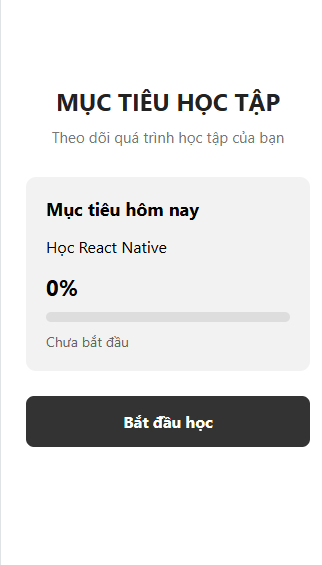
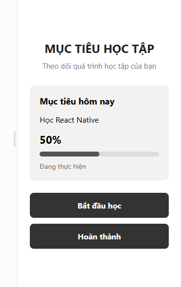
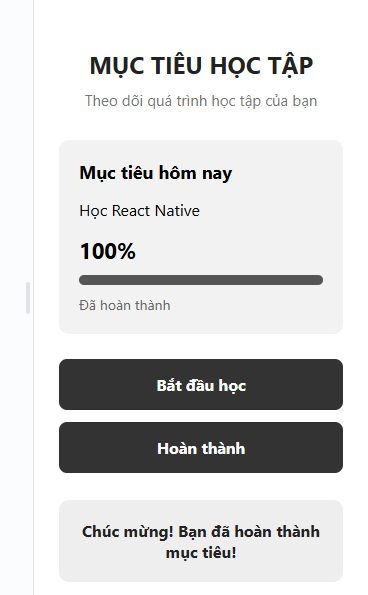

# BÀI TẬP 5: THIẾT KẾ GIAO DIỆN CÓ HIỆU ỨNG ĐỘNG

## 1. Thông tin bài tập

- Tên ứng dụng: AnimateApp
- Công nghệ: React Native
- Công cụ: Expo Snack
- Sinh viên: Huỳnh Thanh Tùng

## 2. Giới thiệu ứng dụng

AnimateApp là ứng dụng theo dõi mục tiêu học tập của người dùng.

Ứng dụng cho phép người dùng bắt đầu học tập, theo dõi tiến độ và nhận thông báo khi hoàn thành mục tiêu.

## 3. Các Component

- **ProgressCard:** Hiển thị mục tiêu học tập và tiến độ học tập.
- **ActionButton:** Tạo nút bắt đầu học và hoàn thành.
- **AnimatedMessage:** Hiển thị thông báo hoàn thành với hiệu ứng phóng to.

## 4. Chức năng ứng dụng

- Hiển thị mục tiêu học tập hôm nay.
- Bắt đầu học tập bằng nút Bắt đầu học.
- Cập nhật tiến độ từ 0% lên 50%.
- Hoàn thành mục tiêu với tiến độ 100%.
- Hiển thị thông báo chúc mừng khi hoàn thành.
- Sử dụng hiệu ứng động khi thông báo xuất hiện.

## 5. Công nghệ sử dụng

- React Native
- JavaScript
- React Hooks: useState, useEffect, useRef
- Animated API

## 6. Hình ảnh giao diện ứng dụng

### 6.1. Giao diện ban đầu

Hiển thị mục tiêu học tập và tiến độ 0%.

### 6.2. Giao diện khi bắt đầu học

Khi nhấn nút Bắt đầu học, tiến độ được cập nhật lên 50%.

### 6.3. Giao diện khi hoàn thành

Khi nhấn nút Hoàn thành, tiến độ đạt 100% và thông báo chúc mừng xuất hiện với hiệu ứng động.

## 7. Link ứng dụng Expo Snack

https://snack.expo.dev/@tung9506/animateapp

## 8. Link GitHub

https://github.com/httung9506-svg/AnimateApp

## 9. Kết luận

Ứng dụng AnimateApp đã xây dựng được giao diện theo dõi mục tiêu học tập bằng React Native.

Ứng dụng sử dụng các Component ProgressCard, ActionButton và AnimatedMessage. Các chức năng bắt đầu học, cập nhật tiến độ, hoàn thành mục tiêu và hiển thị thông báo động đã được thực hiện.

Qua bài tập này, em đã hiểu cách tạo Component, sử dụng React Hooks và áp dụng Animated API trong React Native.

**Bài tập 5 đã hoàn thành.**
